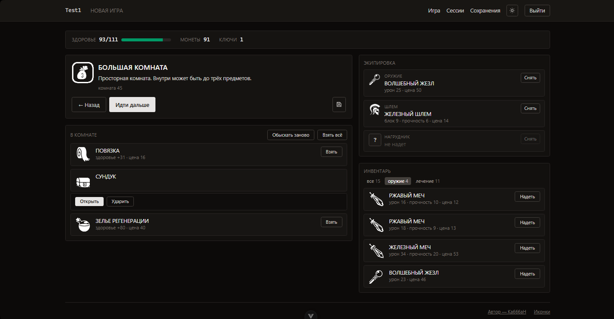

# TextGame

**Текстовая roguelike в браузере — SPA-клиент для [TextGameAPI](https://github.com/Ka666aH/TextGameAPI)** — учебный pet-project.

[](https://github.com/Ka666aH/TextGame/actions/workflows/ci.yml)
[](LICENSE)


---



---

## Игровой процесс

Игрок спускается по процедурно сгенерированному подземелью: комнаты разных типов, враги, сундуки с лутом, предметы экипировки и лечения, торговец. Цель — добраться до выхода, либо погибнуть в попытке.

Все правила игры живут на сервере: клиент не считает урон, не решает, заперт ли сундук, и не хранит состояние партии. Его работа — показать то, что вернул API, и провести действие ровно один раз.

Подземелье строится по сиду: одинаковый сид даёт одинаковые комнаты, предметы и врагов. Бой пошаговый, с прочностью экипировки и случайным уроном.

---

## Технологический стек

| Технология                          | Назначение                                                |
| ----------------------------------- | --------------------------------------------------------- |
| **Vue 3 + TypeScript**              | SFC, `<script setup>`, strict-режим `vue-tsc`             |
| **Vite**                            | Dev-сервер с прокси `/api`, сборка `dist/`                |
| **Vue Router**                      | Экраны и защита маршрутов по факту входа                  |
| **TanStack Query**                  | Всё серверное состояние и правила его обновления          |
| **Pinia**                           | Только UI-состояние: тосты, подтверждения                 |
| **Tailwind CSS 4**                  | Оформление через токены ролей, две темы                   |
| **Vitest**                          | Юнит-тесты логики                                         |
| **Playwright**                      | UI-сценарии на подменённой сети и smoke против живого API |
| **ESLint + oxlint + Prettier**      | Линтеры и форматирование, проверяются в CI                |
| **Docker + nginx + Docker Compose** | Сборка статики и весь стек одной командой                 |

---

## Архитектура

Клиент без собственной бизнес-логики: он знает контракт API и умеет его разбирать.

```
api/         DTO ровно в том виде, как их отдаёт сервер; HTTP-клиент; коды ошибок;
             гарды четырёх форм ответа 200; вид предмета; исход партии
queries/     TanStack Query: ключи кэша, запросы, мутации и правила инвалидации
composables/ блокировка действий на время запроса, клиентский журнал боя
components/  common — шапка, тосты, подтверждение, арт; game — панели игры
views/       экраны: вход, сессии, игра, сохранения, исход, авторы иконок
lib/         чистые функции: форматирование, валидация, навигация, темы, арт, авторы
assets/      иконки существ (по два файла на сущность) и токены тем
```

Решения, которые определяют всё остальное:

- **Серверное состояние не дублируется в Pinia.** Единственный источник правды — кэш TanStack Query; оптимистичных обновлений нет, состояние берётся из ответа или перечитывается.
- **Токены не покидают `httpOnly`-куки.** В JavaScript нет ни чтения токена, ни `Authorization`, ни хранилищ с секретами.
- **Контракт разбирается один раз.** Четыре разные формы `200` различаются гардами по наличию ключа, а не по истинности значения; коды ошибок собраны в одном месте.
- **Тема — не данные с сервера.** Класс на `<html>` и ключ в `localStorage`, цвета — токены ролей, без `dark:`-вариантов.

---

## Возможности

### Аутентификация

- Вход и регистрация, сессия живёт в `httpOnly`-куках; просроченный access-токен обновляется прозрачно
- `401` — разлогин и экран входа (кроме формы входа), `403` — отказ игрового действия, не разлогин
- `429` — понятное сообщение вместо пустого ответа

### Экраны

- Список игр: создать (имя и сид необязательны), выбрать, удалить
- Игра: комната и действия, карта, содержимое комнаты, сундуки, бой, магазин, экипировка, инвентарь
- Сохранения: создать, загрузить, удалить; несъёмные сохранения отвечают отказом, а не падением
- Экран исхода: победа или поражение, новая игра или загрузка сохранения
- Авторы иконок — статичная страница, доступна без входа

### Поведение

- Автообыск комнаты при входе, ручное «Обыскать заново» для обновления
- Журнал боя копится на клиенте и относится к текущему бою
- Кнопки блокируются на время запроса: состояние меняет сервер, второе действие в полёте дало бы гонку
- Светлая и тёмная темы, переключатель в шапке

---

## Быстрый старт

Переменные окружения необязательны: в `.env` лежат рабочие заглушки, поэтому проект запускается сразу после клонирования.

```bash
docker compose up
```

- Сайт: `http://localhost:8080`
- API проксируется через тот же nginx по `/api` — один origin, без CORS
- Health: `http://localhost:8080/api/health`

Остановить: `docker compose down`. Удалить данные вместе с томами: `docker compose down -v`.

### Настройка

| Переменная                                            | По умолчанию                                 | Назначение                                                                 |
| ----------------------------------------------------- | -------------------------------------------- | -------------------------------------------------------------------------- |
| `WEB_PORT`                                            | `8080`                                       | Порт сайта на хосте                                                        |
| `TEXTGAME_API_IMAGE`                                  | `ka666ah/text-game-api:1.2.0`                | Пин образа API — единственное место, где задана версия                     |
| `TEXTGAME_SUBNET`                                     | `10.10.0.0/16`                               | Подсеть compose-сети, которой API доверяет как источнику `X-Forwarded-For` |
| `POSTGRES_DB` / `POSTGRES_USER` / `POSTGRES_PASSWORD` | `text_game_db` / `dev_user` / `dev_password` | База                                                                       |
| `JWT_SECRET`                                          | заглушка                                     | Секрет подписи JWT, минимум 32 символа                                     |

> `.env` с заглушками лежит в репозитории, чтобы проект запускался «из коробки».

---

## Разработка

Фронтенду нужен поднятый бэкенд на `:5000` — например, `docker compose up` в его репозитории.

```bash
pnpm install
pnpm dev        # http://localhost:5173
```

Все запросы идут на относительный `/api`, Vite проксирует их на `:5000`. Так клиент и сервер остаются на одном origin: CORS на бэкенде нет, а отпечаток refresh-куки привязан к origin.

| Команда                                               | Что делает                                                                |
| ----------------------------------------------------- | ------------------------------------------------------------------------- |
| `pnpm dev`                                            | Дев-сервер с прокси на бэкенд                                             |
| `pnpm build`                                          | `type-check` + сборка в `dist/`                                           |
| `pnpm type-check`                                     | `vue-tsc`                                                                 |
| `pnpm lint`                                           | oxlint и eslint с автоисправлениями                                       |
| `pnpm format`                                         | Prettier по `src/`                                                        |
| `pnpm test:unit`                                      | Vitest: гарды, исход партии, вид предмета, формат, валидация, обвязка API |
| `pnpm test:e2e`                                       | Playwright: UI-сценарии на подменённой сети, бэкенд не нужен              |
| `SMOKE=1 pnpm exec playwright test e2e/smoke.spec.ts` | Проверка контракта против живого API                                      |

Для e2e один раз нужен браузер: `pnpm exec playwright install chromium`. По умолчанию идёт только Chromium и без окна; `HEADED=1` откроет окно, `ALL_BROWSERS=1` добавит Firefox и WebKit.

---

## Устройство проекта

```
src/          код приложения (см. «Архитектура»)
e2e/          UI-сценарии Playwright, заглушки сети и smoke-спек против живого API
deploy/       серверный блок nginx для выкладки
docs/         скриншоты
Dockerfile    сборка статики и раздача тем же nginx-конфигом
```

Внутренние заметки проекта (`notes/`) в git не входят.

---

## Что стоит знать о бэкенде

- **`200` бывает четырёх форм:** `GameInfo`, `GameOver`, `BattleWin` и массив логов боя. Различаются гардами по наличию ключа; `BattleWin` и `GameOver` отличает только `battleLog`.
- **Исход партии приходит полем `result`** (`win` / `lose` / `null`). Эвристика по комнате «ВЫХОД» и здоровью осталась фолбэком для состояний до 1.2.0 — см. `src/api/outcome.ts`.
- **Предметы полиморфны и без дискриминатора:** вид выводится по набору полей, а где поля бессильны (ключ, карта, монеты, неизвестное зелье) — по точному имени.
- **Лимит авторизации — 5 запросов в минуту с одного IP**, общий для входа, регистрации и выхода. Ответ приходит с телом и `Retry-After`.
- **Сид передаётся и принимается строкой:** 64-битное значение не влезает в JSON-число без потери точности.

---

## CI

`.github/workflows/ci.yml`, на каждый push в `main` и pull request:

- **frontend** — oxlint и eslint без `--fix`, `vue-tsc`, Vitest, сборка, затем `docker compose config -q` и `docker build`: ровно тот путь, которым проект запускается.
- **e2e** — preview-сборка и API из образа `TEXTGAME_API_IMAGE`, UI-сценарии на подменённой сети, после них smoke-спек без моков: регистрация, сессия, проверка полей контракта, тело `403`, удаление игры. При падении выгружаются трейсы Playwright.

---

## Иконки

Иконки предметов, комнат и врагов нарисованы не нами. Авторы, ссылки и лицензии — на странице `/credits` (ссылка в подвале приложения); единственный источник списка — `src/lib/credits.ts`. Там же формулировки, которых требуют источники: CC BY 3.0 для [game-icons.net](https://game-icons.net) и подпись автора для [Flaticon](https://www.flaticon.com).

---

## Как это сделано

Клиент написан c использованием агентной разработки. Агент писал код, тесты и документацию. Автор — задачи, архитектурные решения, ревью.

Инструменты: **DeepSeek V4.1 Flash 1017** + **DeepSeek Harness**.

---

## Лицензия

[MIT](LICENSE) © 2026 Ka666aH
